<div align="center">

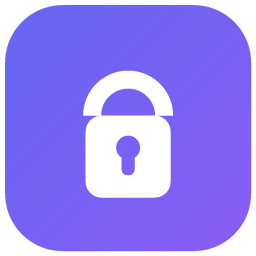

# MySecrets

**Senhas, códigos 2FA, tokens e arquivos sensíveis em um cofre cifrado.**
**Um único cofre para PC, celular, navegador e assistentes de IA.**

[](https://github.com/plugato/mySecrets/releases)
[](LICENSE)
[](https://github.com/plugato/mySecrets/actions)


[**Baixar**](https://github.com/plugato/mySecrets/releases) ·
[Recursos](#-recursos) ·
[Prints](#-prints) ·
[Início rápido](#-início-rápido) ·
[Exemplos](#-exemplos) ·
[Segurança](#-segurança) ·
[Documentação](#-documentação)

<br>

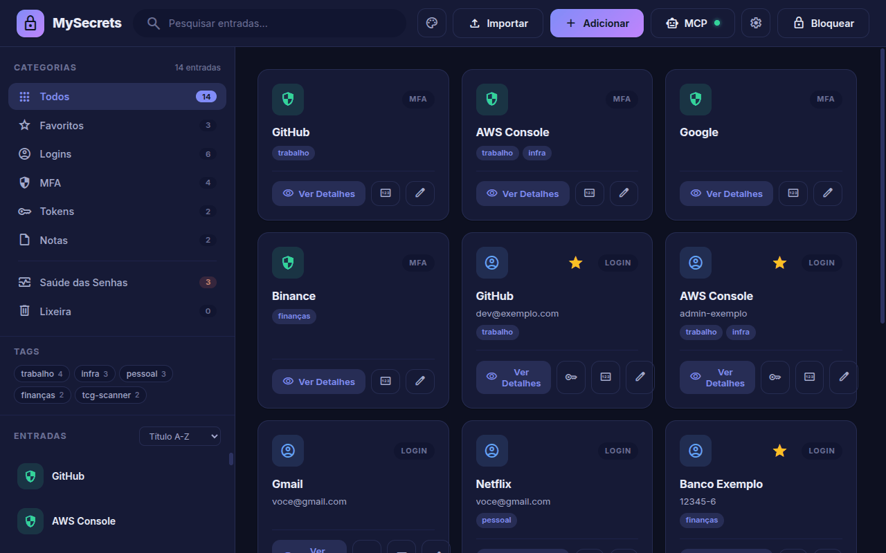

</div>

---

## ✨ Por que o MySecrets?

- 🔐 **Seu cofre fica com você.** Os dados ficam em um único arquivo (`secrets.enc`), cifrado com AES-256-GCM. Não há servidor nem conta no MySecrets.
- 📱 **O mesmo cofre em todo lugar.** Desktop (Windows/Linux) e Android abrem o mesmo arquivo, sincronizado pelo **seu** Google Drive. A mesclagem é feita por entrada.
- 🧩 **Preenchimento automático no Chrome e no Android**, incluindo o código 2FA na hora certa.
- 🤖 **Assistentes de IA com permissão.** Claude Code e outros clientes MCP leem credenciais com o cofre aberto, e **só gravam depois que você aprova** no app.
- 👆 **Desbloqueio por digital**: Windows Hello no PC, biometria no Android, ou **aprovação do login do PC pelo celular**.

---

## 🎯 Recursos

<table>
<tr>
<td width="50%" valign="top">

### 🖥️ App desktop
- Logins, **MFA (TOTP/HOTP)**, tokens de API e notas seguras
- Leitura de QR code `otpauth://` (arraste a imagem)
- **Anexos cifrados** (keystore, `.pem`, `.json`, `.env`), até 1 MB cada
- **Tags por projeto**, favoritos, busca e lixeira
- **Saúde das senhas**: reutilizadas, fracas e antigas
- Gerador de senhas e limpeza automática da área de transferência
- Bloqueio automático e bloqueio ao suspender o PC
- Importa do **Bitwarden** e do **Proton Pass**
- Backup automático e restauração
- 5 temas: escuro, claro, ocean, forest e sunset
- Atualização automática pelo GitHub Releases

</td>
<td width="50%" valign="top">

### 📲 App Android
- Abre o **mesmo `secrets.enc`** do PC
- Sincroniza pelo Google Drive com a mesma conta
- **Preenchimento automático no sistema todo**: apps e navegadores (Chrome, Firefox, Brave, Edge, Samsung Internet…)
- Oferece salvar os logins novos
- Desbloqueio por digital (chave no Android Keystore)
- **Aprova o login do PC**: confere o código e encosta o dedo, na mesma rede Wi-Fi e sem servidor

### 🌐 Extensão Chrome
- Lista os logins do site atual e preenche com um clique
- `Ctrl+Shift+A`: preenche com a primeira correspondência
- **Nenhuma cópia do cofre no navegador**: pergunta ao app desbloqueado

### 🤖 Servidor MCP
- `list_secrets`, `search_secrets`, `get_credentials`, `get_otp`, `get_secret_file`
- `store_secret`, `store_secret_file` **com confirmação no app**

</td>
</tr>
</table>

---

## 📸 Prints

> As imagens usam um cofre de demonstração. Nenhum dado real aparece.

### 🖥️ Desktop

<table>
<tr>
<td width="50%" align="center">
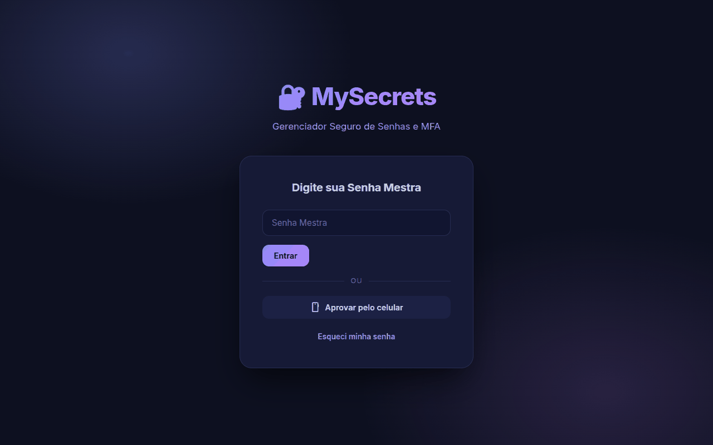<br>
<sub><b>Login</b>: senha mestra ou aprovação pelo celular</sub>
</td>
<td width="50%" align="center">
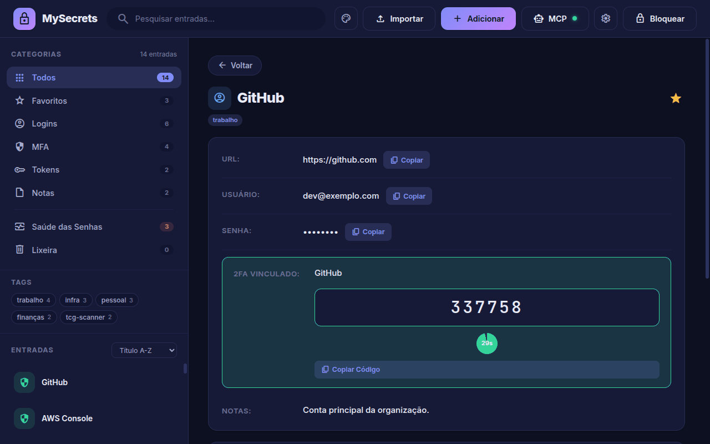<br>
<sub><b>Login com 2FA vinculado</b>: o código fica ao lado da senha</sub>
</td>
</tr>
<tr>
<td align="center">
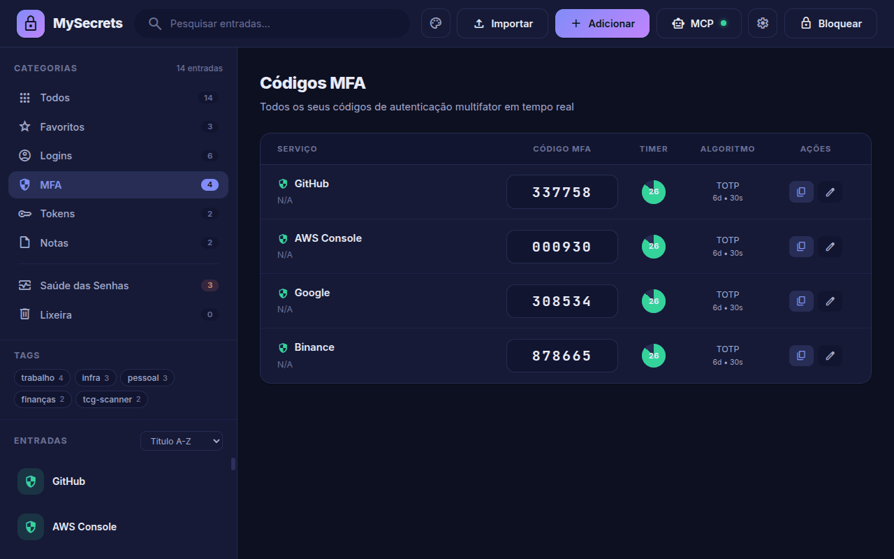<br>
<sub><b>Códigos MFA</b>: todos os TOTP em tempo real</sub>
</td>
<td align="center">
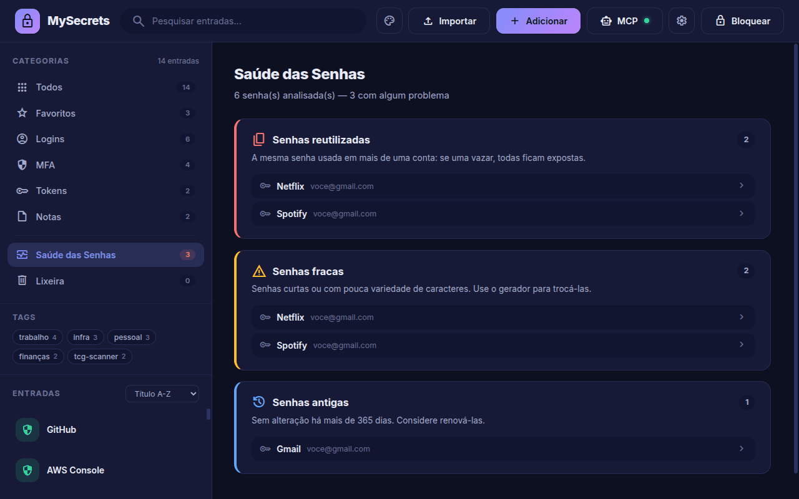<br>
<sub><b>Saúde das senhas</b>: senhas reutilizadas, fracas e antigas</sub>
</td>
</tr>
<tr>
<td align="center">
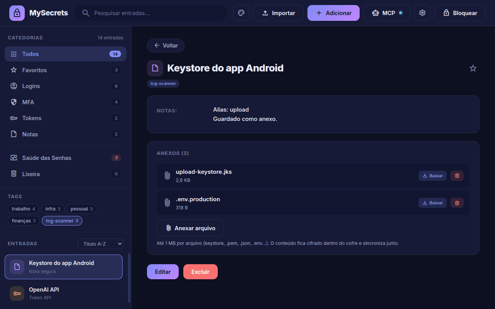<br>
<sub><b>Anexos cifrados</b> e filtro por tag de projeto</sub>
</td>
<td align="center">
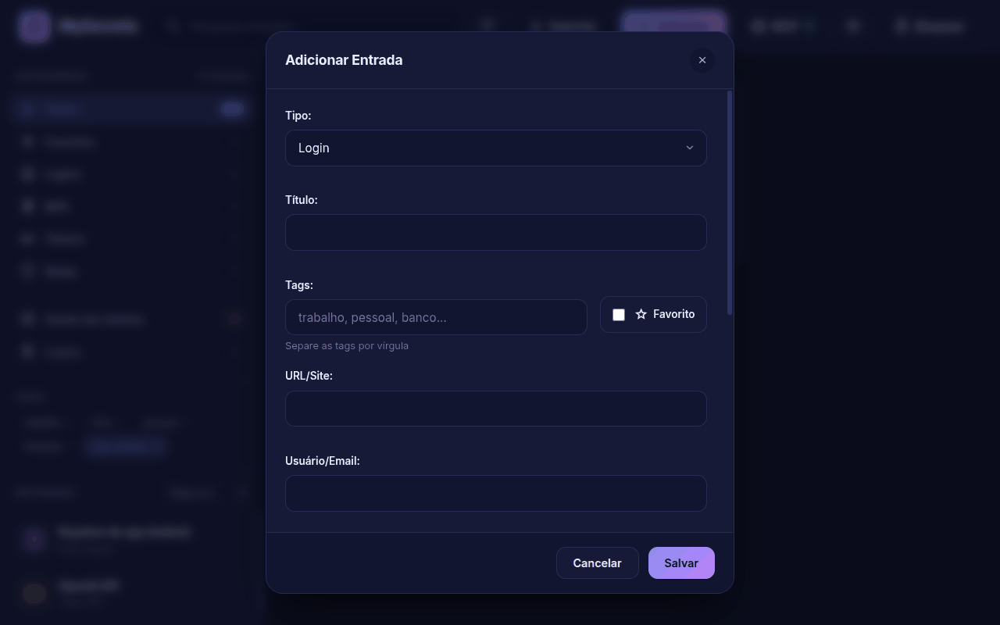<br>
<sub><b>Nova entrada</b>: login, MFA, token ou nota</sub>
</td>
</tr>
<tr>
<td align="center">
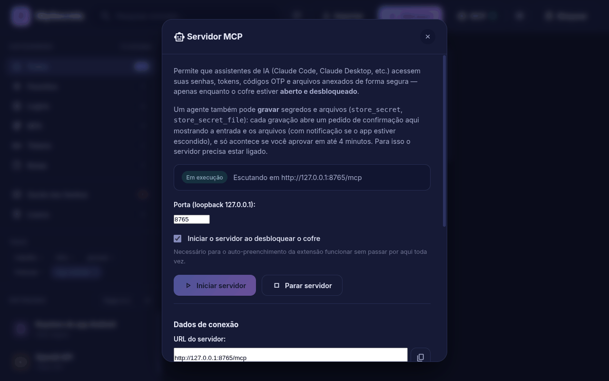<br>
<sub><b>Servidor MCP</b>: URL, token e comando para o Claude Code</sub>
</td>
<td align="center">
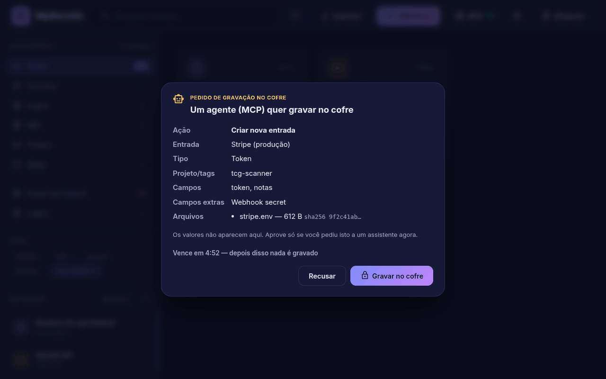<br>
<sub><b>Gravação por agente</b>: nada é gravado sem a sua aprovação</sub>
</td>
</tr>
<tr>
<td align="center">
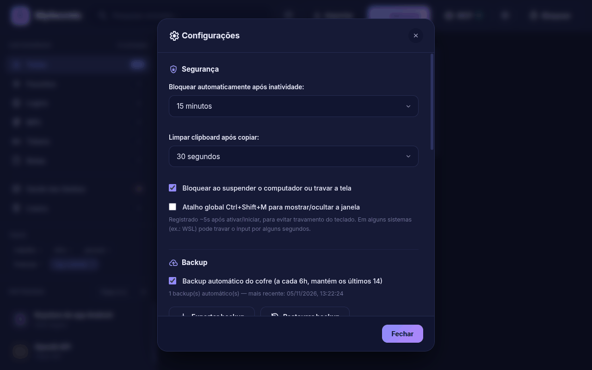<br>
<sub><b>Configurações</b>: bloqueio, área de transferência, backup e sincronização</sub>
</td>
<td align="center">
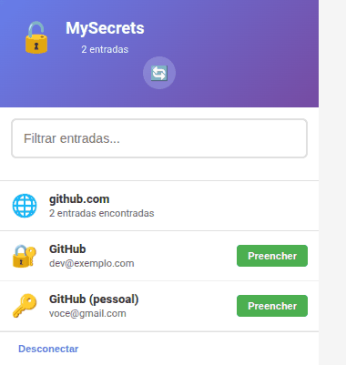<br>
<sub><b>Extensão Chrome</b>: logins do site atual</sub>
</td>
</tr>
</table>

### 📲 Android

<div align="center">
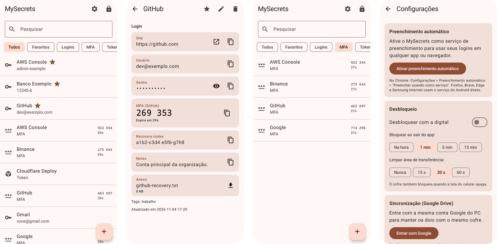<br>
<sub><b>App Android</b>: o mesmo cofre do PC, com 2FA, preenchimento automático e desbloqueio por digital</sub>
</div>

### 🎨 Temas

<div align="center">
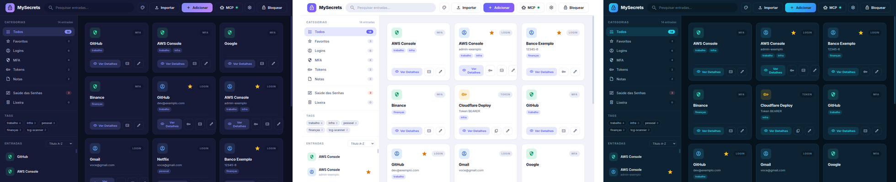<br>
<sub>Temas <b>escuro</b>, <b>claro</b> e <b>ocean</b> (há também forest e sunset)</sub>
</div>

---

## ⚡ Início rápido

### Baixar e instalar

Os instaladores estão na página de **[Releases](https://github.com/plugato/mySecrets/releases)**:

| Plataforma | Arquivo |
|---|---|
| 🪟 Windows | `MySecrets-Setup-<versão>.exe` (instalador) ou `MySecrets-<versão>-portable.exe` |
| 🐧 Linux | `.AppImage`, `.deb` ou `.tar.gz` (x64 e arm64) |
| 🤖 Android | `MySecrets-<versão>-android.apk` (veja [android/README.md](android/README.md)) |

### Rodar pelo código-fonte

```bash
git clone https://github.com/plugato/mySecrets.git
cd mySecrets
npm install
make dev          # ou: npm run dev
```

Na primeira vez, crie a **senha mestra** (mínimo de 8 caracteres).

> [!WARNING]
> **A senha mestra não tem recuperação.** Ela nunca é gravada em lugar nenhum. Se você esquecer a senha, o cofre não pode ser aberto.

📖 Passo a passo detalhado: **[QUICK_START.md](QUICK_START.md)**

---

## 🧪 Exemplos

### 1. Conectar o Claude Code ao cofre

```bash
# Opção A: servidor stdio (o comando make mostra o caminho certo)
make mcp-config
claude mcp add --scope user mysecrets -- node "$(pwd)/mcp-server/index.js"

# Opção B: servidor HTTP do app (MCP → Iniciar servidor → copiar)
claude mcp add --transport http mysecrets http://127.0.0.1:8765/mcp \
  --header "Authorization: Bearer <token mostrado no app>"
```

Depois, é só pedir em linguagem natural (saída ilustrativa):

```text
Você › Pega o usuário e a senha do AWS Console e o código 2FA atual.
Claude › get_credentials { "query": "aws console" }
         → usuário: admin-exemplo · senha: •••• · otp: 618302 (expira em 21s)

Você › Guarda o stripe.env no cofre, na tag tcg-scanner.
Claude › store_secret { "title": "Stripe (produção)", "tags": ["tcg-scanner"],
                        "files": [{ "path": "/home/eu/projeto/stripe.env" }] }
         → ⏳ aguardando sua confirmação no MySecrets…
         → ✅ gravado (você aprovou no app)
```

O pedido de gravação abre o [diálogo de confirmação](docs/screenshots/confirmacao-agente.png) no app. Ele mostra a entrada, os campos e o nome, o tamanho e o hash de cada arquivo. Se você não aprovar dentro do prazo, nada é gravado.

### 2. Adicionar um 2FA a partir de QR code ou URI

Em **Adicionar → MFA**, arraste a imagem do QR code ou cole a URI:

```text
otpauth://totp/GitHub:dev@exemplo.com?secret=JBSWY3DPEHPK3PXP&issuer=GitHub&digits=6&period=30
```

Depois, vincule a entrada MFA ao login do GitHub. O código passa a aparecer ao lado da senha, e a extensão e o Android preenchem o código junto com a senha.

### 3. Importar de outro gerenciador

**Importar** aceita:

| Origem | Formato |
|---|---|
| MySecrets | export `.json` |
| Bitwarden | export `.json` (sem criptografia) |
| Proton Pass | `.zip`, `.json` ou `.csv` (sem criptografia) |

Antes de importar, o app mostra uma prévia. Você pode pular as entradas duplicadas.

### 4. Parear a extensão Chrome

```bash
make ext-integrate   # mostra o passo a passo
make ext-check       # confere se o servidor local (127.0.0.1:8765) está no ar
```

1. Em `chrome://extensions`, ative o **Modo do desenvolvedor** e use **Carregar sem compactação** com a pasta `chrome-extension/`.
2. No app, vá em **MCP → Iniciar servidor → Extensão (autofill)** e copie o código de pareamento.
3. Na extensão, cole o código e clique em **Conectar**.

---

## 🏗️ Arquitetura

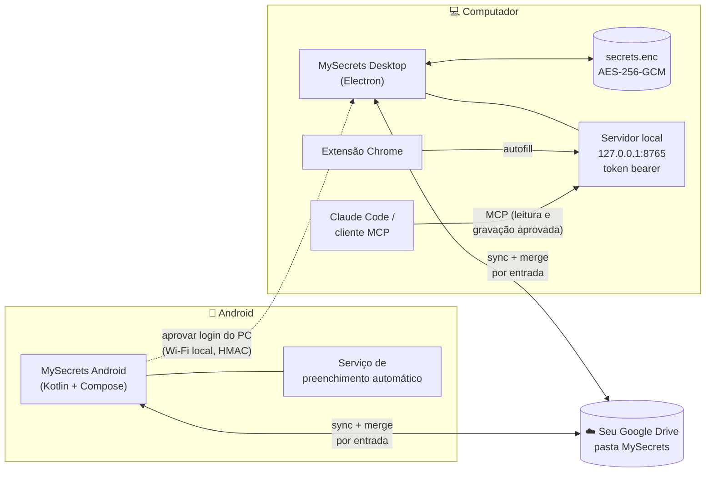

---

## 🔐 Segurança

| Camada | Como funciona |
|---|---|
| **Cifra do cofre** | AES-256-**GCM** (autenticada). Se o arquivo for adulterado, a leitura falha. |
| **Derivação de chave** | PBKDF2-SHA256 com **600.000 iterações** e salt aleatório a cada gravação. |
| **Formato legado** | Cofres antigos (AES-256-CBC, 100k iterações) são migrados automaticamente no primeiro desbloqueio. |
| **Electron** | `contextIsolation` ligado, `nodeIntegration` desligado e CSP restritiva no renderer. |
| **Servidor local** | Escuta só em loopback, exige token em toda chamada e bloqueia páginas web pela origem. |
| **Agentes de IA** | Leitura só com o cofre aberto. Toda gravação passa por uma confirmação explícita no app. |
| **Android** | Chave biométrica no Keystore. O build de release bloqueia captura de tela. |
| **Celular → PC** | A senha mestra fica cifrada com uma chave que só sai do celular depois da digital. As mensagens usam HMAC, e cada nonce só vale uma vez. |

📖 Detalhes em **[docs/user/SECURITY.md](docs/user/SECURITY.md)** e no protocolo em [`src/lib/phone-link.js`](src/lib/phone-link.js).

---

## 🚀 Comandos

```bash
make dev            # app em modo desenvolvimento (DevTools)
make start          # app em modo produção
make test           # testes (node --test)
make build-linux    # AppImage, .deb e .tar.gz
make build-win      # instalador e versão portátil para Windows
make mcp-config     # mostra como registrar o servidor MCP
make ext-check      # verifica o servidor local da extensão
make                # lista todos os comandos
```

<details>
<summary><b>📂 Estrutura do projeto</b></summary>

```
mySecrets/
├── src/                      # App desktop (Electron)
│   ├── main.js               # Processo principal: cofre, IPC, servidor local, updates
│   ├── preload.js            # API segura exposta ao renderer
│   ├── lib/                  # Cripto, sync, Google Drive, pareamento com celular
│   └── renderer/             # Interface (HTML/CSS/JS)
├── android/                  # App Android (Kotlin + Jetpack Compose)
├── chrome-extension/         # Extensão Chrome (Manifest V3)
├── mcp-server/               # Servidor MCP (stdio e HTTP)
├── tests/                    # Testes Node + vetores compartilhados com o Android
├── docs/                     # Documentação e prints
└── Makefile                  # Atalhos de desenvolvimento
```

</details>

<details>
<summary><b>🆘 Problemas comuns</b></summary>

| Sintoma | O que fazer |
|---|---|
| App não abre | `make reinstall && make dev` |
| Extensão diz "App fechado ou servidor parado" | Abra o app, desbloqueie o cofre e inicie o servidor em **MCP** |
| Extensão diz "Token inválido" | Copie o código de pareamento no app de novo |
| Assistente de IA diz "cofre bloqueado" | Desbloqueie o app. O MCP só responde com o cofre aberto |
| Login do Google falha no Android 15/MIUI | Atualize para a versão 2.0.1 ou mais nova |
| Esqueci a senha mestra | ⚠️ Não há recuperação. Comece um cofre novo |

</details>

---

## 📚 Documentação

| | Documento | Conteúdo |
|---|---|---|
| 👤 | [QUICK_START.md](QUICK_START.md) | Começar em 5 minutos |
| 👤 | [docs/user/INSTALLATION.md](docs/user/INSTALLATION.md) | Instalação detalhada |
| 🔐 | [docs/user/SECURITY.md](docs/user/SECURITY.md) | Segurança e criptografia |
| 📲 | [android/README.md](android/README.md) | App Android, autofill e aprovação do login do PC |
| 🌐 | [chrome-extension/README_EXTENSION.md](chrome-extension/README_EXTENSION.md) | Extensão Chrome |
| 🤖 | [mcp-server/README.md](mcp-server/README.md) | Servidor MCP: ferramentas e gravação com confirmação |
| 💻 | [docs/developer/DEVELOPER_GUIDE.md](docs/developer/DEVELOPER_GUIDE.md) | Guia técnico |
| 🤝 | [docs/developer/CONTRIBUTING.md](docs/developer/CONTRIBUTING.md) | Como contribuir |
| 📝 | [docs/developer/CHANGELOG.md](docs/developer/CHANGELOG.md) | Histórico de versões |
| 🛠️ | [docs/guides/MAKEFILE_GUIA.md](docs/guides/MAKEFILE_GUIA.md) | Todos os comandos `make` |

---

## 🔧 Tecnologias

**Desktop:** Electron · Node.js `crypto` · otplib · qrcode · jsQR · electron-updater
**Android:** Kotlin · Jetpack Compose · Android Keystore · Autofill Framework · Google Drive API
**Integrações:** Chrome Extensions (Manifest V3) · Model Context Protocol (MCP)

---

<div align="center">

**[MIT License](LICENSE)** · Feito com ❤️ para manter suas senhas seguras e organizadas.

⭐ Se o MySecrets for útil para você, deixe uma estrela no repositório.

</div>
