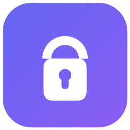
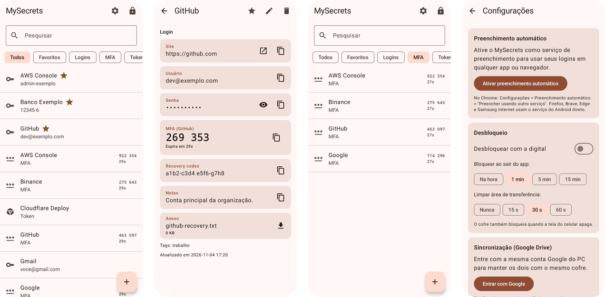
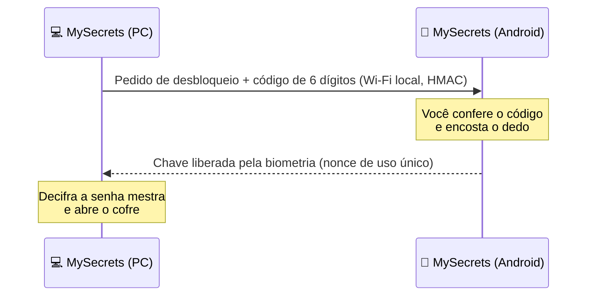
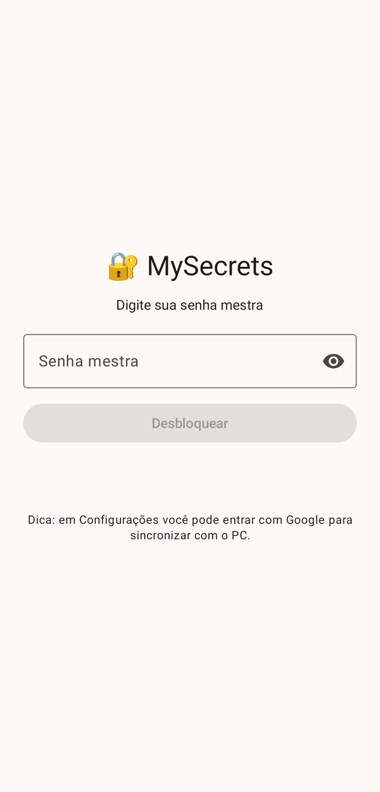
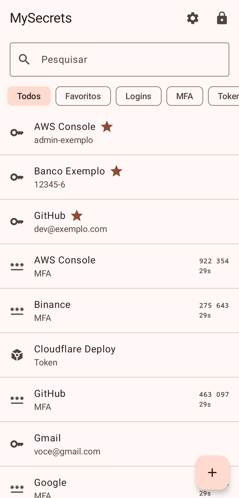
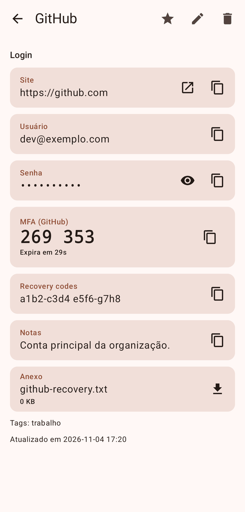
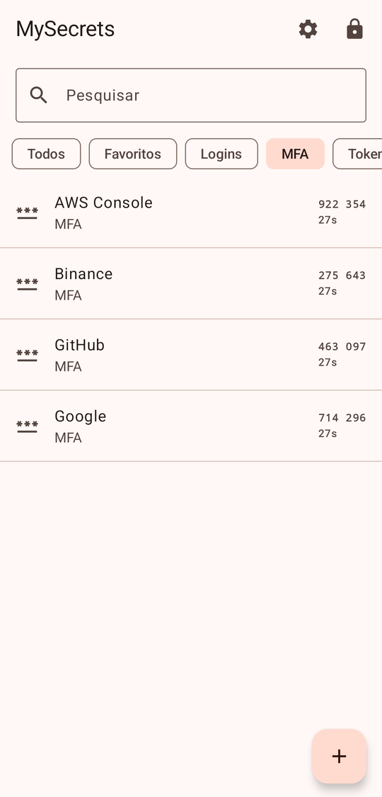
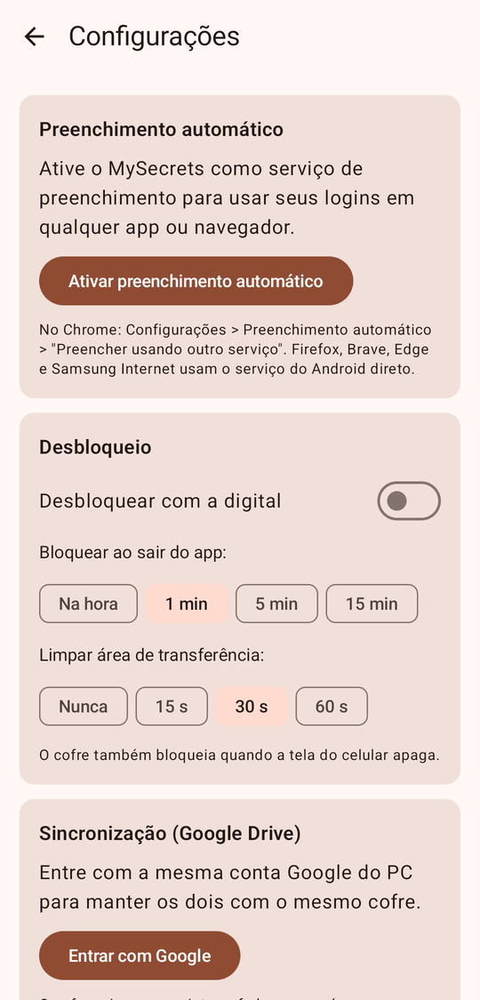

<div align="center">



# 📲 MySecrets para Android

**O mesmo cofre do seu PC no bolso: senhas, 2FA, preenchimento automático e aprovação do login do PC com a digital.**


[**⬇️ Baixar APK**](https://github.com/plugato/mySecrets/releases)

<br>



</div>

---

## ✨ O que faz

| | Recurso | Detalhes |
|---|---|---|
| 🔐 | **Cofre** | Logins, MFA (TOTP/HOTP, leitura de QR `otpauth://`), tokens, notas seguras e anexos. Usa o mesmo formato do desktop (`secrets.enc`, AES-256-GCM + PBKDF2-SHA256 com 600 mil iterações). |
| ☁️ | **Sincronização pelo Google Drive** | Mesma conta, mesma pasta `MySecrets` e a mesma mesclagem por entrada que o desktop usa. |
| 🌐 | **Preenchimento automático no Android inteiro** | Funciona em apps e navegadores. Sugere os logins do site ou app, preenche usuário, senha e código MFA, e oferece salvar os logins novos. |
| 👆 | **Desbloqueio por digital** | Usa uma chave no Android Keystore. |
| 💻 | **Aprovar o login do PC** | Veja [abaixo](#-aprovar-o-login-do-pc-pelo-celular). |



## 📸 Telas

<table>
<tr>
<td align="center" width="20%"><br><sub>Desbloqueio</sub></td>
<td align="center" width="20%"><br><sub>Cofre com códigos MFA ao vivo</sub></td>
<td align="center" width="20%"><br><sub>Login com 2FA e anexo</sub></td>
<td align="center" width="20%"><br><sub>Filtro MFA</sub></td>
<td align="center" width="20%"><br><sub>Autofill, digital e sync</sub></td>
</tr>
</table>

> Prints feitos com um cofre de demonstração.

## 🚀 Primeiro uso

1. Instale o APK da página de [Releases](https://github.com/plugato/mySecrets/releases).
2. Toque em **Entrar com Google e baixar meu cofre**, usando a mesma conta configurada no PC, e digite a senha mestra.
3. Em **Configurações**:
   - toque em **Ativar preenchimento automático**;
   - no Chrome, ligue *Configurações > Preenchimento automático > Preencher usando outro serviço*.

## 💻 Aprovar o login do PC pelo celular

1. No PC, abra *Configurações > Celular Android > Parear celular*. Um QR code aparece na tela.
2. No celular, toque em *Configurações > Parear com PC* e leia o QR. Confirme com a digital.
3. A partir daí, a tela de login do PC tem o botão **Aprovar pelo celular**. Com o celular na mesma rede Wi-Fi e o app aberto, aparece o pedido com um código de 6 dígitos. Confira se é o mesmo código do PC e toque em **Aprovar com digital**.

> [!TIP]
> **Como a aprovação é protegida:**
> - A senha mestra fica no PC cifrada com uma chave que só o celular tem, e essa chave só sai do celular depois da digital.
> - As mensagens são autenticadas com HMAC usando o segredo do pareamento, e cada nonce vale uma única vez.
> - O protocolo está descrito em [`src/lib/phone-link.js`](../src/lib/phone-link.js).

## 🛠️ Desenvolvimento

```bash
cd android
./gradlew testDebugUnitTest assembleDebug   # testes de compatibilidade + APK de debug
./gradlew assembleRelease                   # precisa de keystore.properties (ou ANDROID_KEYSTORE_*)
```

- **Testes de compatibilidade**: os testes Kotlin leem `../tests/fixtures/`, vetores gerados pelo código Node do desktop. Assim, o celular e o PC abrem os mesmos arquivos e falam o mesmo protocolo.
- **Login com Google**: o build usa o `src/google-oauth.json` do desktop, ou, no CI, as variáveis `GOOGLE_CLIENT_ID` e `GOOGLE_CLIENT_SECRET`. É o mesmo OAuth client do desktop (redirecionamento loopback).
- **Assinatura**: o arquivo `android/keystore.properties` (ignorado pelo git) aponta para `~/.config/mysecrets-android/release.jks`. **Faça backup dessa chave.** Sem ela, o Android não instala atualizações por cima da versão anterior.
- **Build de debug**: usa o pacote `com.mysecrets.app.debug` e permite captura de tela. O build de release bloqueia captura de tela.
- **Teste do pareamento sem rede**: rode `MYSECRETS_PHONE_HOSTS=127.0.0.1` no desktop e `adb forward tcp:47653 tcp:47653` para o PC conversar com um emulador.
