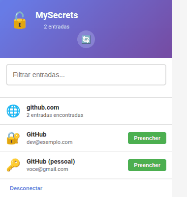

<div align="center">

# 🌐 MySecrets Autofill

**Extensão para Chrome e Firefox que preenche login, senha e código 2FA com o cofre do app desktop.**




</div>

A extensão **não guarda o cofre nem a senha mestra**. Ela pergunta ao app, que
só responde com o cofre aberto e desbloqueado.

## Como funciona

```
Extensão  --(HTTP + token)-->  127.0.0.1:8765  --(sessão)-->  cofre do app
```

**Passkeys:** quando um site cria uma passkey, a extensão oferece salvar no
MySecrets (você confirma no app); depois, para entrar, mostra as passkeys do
site. A chave fica no cofre; "Usar outro dispositivo" deixa com o navegador.

O app sobe um servidor local (o mesmo usado pelos assistentes de IA), escutando
só em loopback e exigindo um token bearer. O token chega à extensão por um
código de pareamento que você copia no app. Fechou o app ou bloqueou o cofre, a
extensão fica sem dados.

## Instalação no Chrome (uma vez)

1. Chrome → `chrome://extensions/` → ative **Modo do desenvolvedor**
2. **Carregar sem compactação** → selecione a pasta `chrome-extension/`
3. No app MySecrets: **MCP** → **Iniciar servidor** → marque
   *"Iniciar o servidor ao desbloquear o cofre"*
4. Copie o **Código de pareamento da extensão** (abaixo do token)
5. Clique no ícone da extensão → cole o código → **Conectar**

## Instalação no Firefox

O mesmo código funciona no Firefox 140 ou mais novo.

- **Para testar:** `about:debugging#/runtime/this-firefox` → **Carregar extensão
  temporária…** → escolha `chrome-extension/manifest.json`. Extensões
  temporárias somem ao fechar o Firefox.
- **Para uso diário:** gere o pacote com `make ext-firefox`
  (`dist/mysecrets-autofill-extensao-firefox.zip`) e envie em
  [addons.mozilla.org](https://addons.mozilla.org/developers/) para ser
  assinado, publicado na loja ou só para você (distribuição própria). O
  Firefox comum só instala extensões assinadas.

O pareamento é igual: na primeira vez o app pergunta se a extensão pode
conectar.

## Uso

- Ícone da extensão: lista os logins do site atual → **Preencher**
- `Ctrl+Shift+A`: preenche direto com a primeira correspondência
- Clique direito num campo → *Preencher com MySecrets*
- `Ctrl+Shift+L`: desconecta a extensão do app

O código 2FA é buscado no momento do preenchimento, então nunca vai expirado.

## Correspondência de site

Um login aparece quando a URL cadastrada nele é do **mesmo site** da página:
mesmo host (`www.` é ignorado) ou mesmo domínio registrável, segundo a Public
Suffix List (`app.exemplo.com.br` e `exemplo.com.br` são o mesmo site;
`fulano.github.io` e `ciclano.github.io` não são). Não há busca por trecho de
texto: `hub.com` não recebe o login de `github.com`. Um login salvo com `https`
não é oferecido numa página `http`, e `localhost`/IPs comparam também a porta.

Cadastre a URL no login do app para que ele apareça aqui. Logins sem URL não
são oferecidos automaticamente.

Antes de preencher, a extensão confere de novo a página da aba: se ela navegou
para outro site depois de você abrir o popup, nada é enviado.

## Problemas

| Sintoma | Causa |
|---|---|
| "App MySecrets fechado ou servidor local parado" | Abra o app e inicie o servidor em **MCP** |
| "Token inválido — refaça o pareamento" | O token do app mudou (ex.: app reinstalado do zero): copie o código de novo |
| "Cofre bloqueado" | Desbloqueie o app |
| Nenhuma entrada no site | O login cadastrado não tem a URL do site |

## Segurança

- Servidor só em `127.0.0.1`, token obrigatório em toda chamada
- Páginas web comuns são bloqueadas por origem (`Origin`), mesmo com o token
- O código de pareamento é recusado se apontar para fora do seu computador
- Senha e OTP só saem do app na hora do preenchimento — a lista do popup traz
  apenas título e usuário
