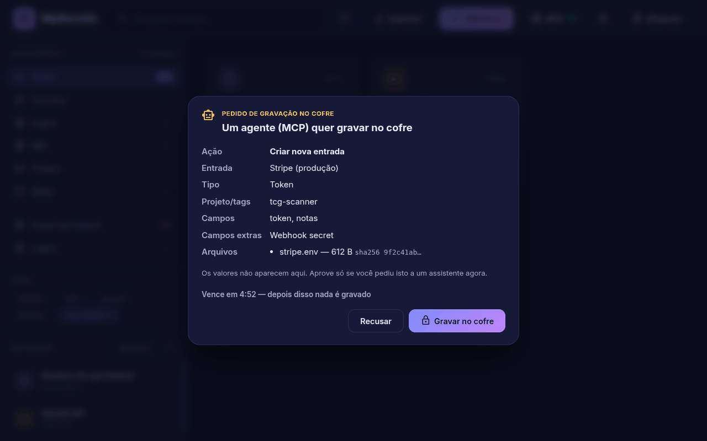
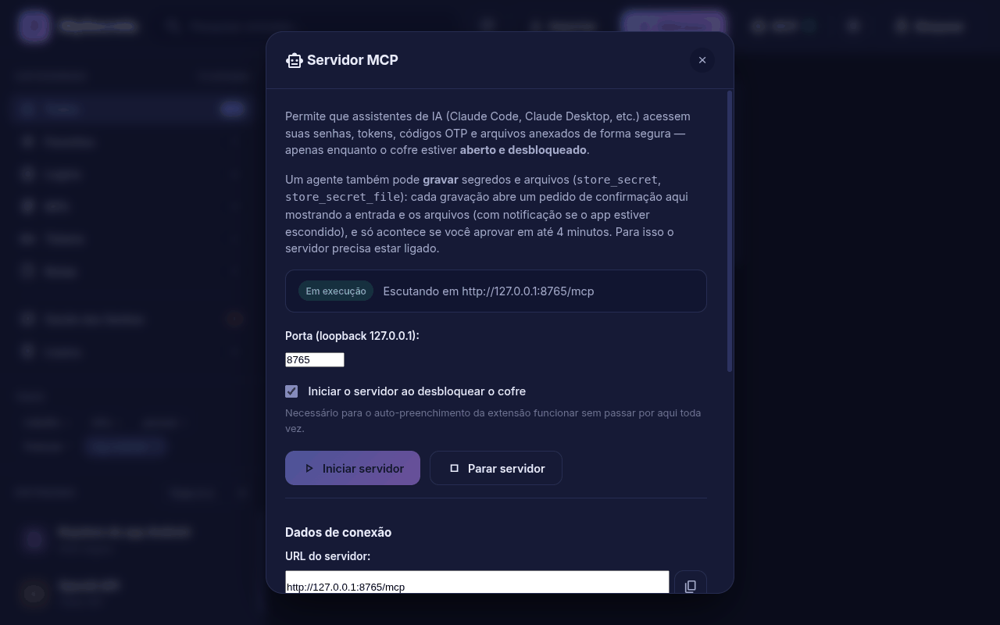

<div align="center">

# 🤖 MySecrets MCP Server

**Dê ao Claude Code (e a qualquer cliente MCP) acesso ao seu cofre, com você no controle.**


</div>

Servidor [MCP](https://modelcontextprotocol.io) que expõe o seu cofre do
**MySecrets** (senhas, tokens, OTPs/2FA e arquivos anexados) para clientes como
**Claude Code**, **Claude Desktop** e outros assistentes compatíveis com MCP.

Além de ler, um agente pode **gravar** segredos e arquivos (keystore, `.pem`,
`.json` de conta de serviço, `.env`, chaves binárias) no cofre, sempre com a sua
confirmação na janela do app.

## Como funciona (segurança)

Este servidor **não guarda a senha mestra**. Ele reaproveita exatamente o mesmo
modelo de segurança da extensão Chrome (native host):

1. Você abre o app **MySecrets** e **desbloqueia** o cofre.
2. O app grava um arquivo de sessão criptografado (`.session`) contendo a senha
   mestra, válido por **15 minutos** e amarrado à máquina/processo.
3. O servidor MCP lê essa sessão, descriptografa `secrets.enc` em memória e
   responde às ferramentas.

Se o app estiver **fechado, bloqueado ou a sessão expirou**, nenhuma ferramenta
devolve segredos — retorna um erro pedindo para desbloquear o app.

## Ferramentas disponíveis

| Ferramenta | O que faz |
|------------|-----------|
| `vault_status` | Diz se o cofre está acessível (app aberto e desbloqueado). |
| `list_secrets` | Lista entradas **sem** expor senhas/segredos. |
| `search_secrets` | Busca por título, URL/domínio, usuário ou tag (sem senhas). |
| `match_url` | Entradas do mesmo site de uma URL (host ou domínio registrável, pela Public Suffix List). Usado pela extensão. |
| `get_credentials` | Retorna usuário + senha (e OTP vinculado, se houver). |
| `get_otp` | Gera o código OTP/TOTP atual de uma entrada. |
| `get_secret_file` | Salva um anexo da entrada num caminho local (permissão 600). |
| `store_secret` | Cria/atualiza uma entrada com campos de texto e arquivos. **Pede confirmação no app.** |
| `store_secret_file` | Anexa um arquivo local a uma entrada. **Pede confirmação no app.** |

Identifique a entrada por `id` (exato) ou por `query` (busca textual — usa o
resultado mais relevante). A busca também olha as tags (ex.: `tcg-scanner`) e
os nomes dos anexos. `get_credentials` devolve também `token`, `customFields` e
os metadados dos anexos (nome, tamanho, sha256), sem o conteúdo.

## Gravar segredos e arquivos (agentes)

<p align="center">
<br>
<sub>Pedido de gravação de um agente: entrada, campos, arquivos (com tamanho e sha256) e prazo. Nada é gravado sem <b>Gravar no cofre</b>.</sub>
</p>

### Como a gravação funciona

1. O agente chama `store_secret` ou `store_secret_file`.
2. O servidor MCP confere os argumentos, lê os arquivos dos caminhos locais
   informados (até **1 MB** cada) e calcula tamanho e sha256.
3. O pedido vai ao app MySecrets (o servidor HTTP é filho do app e fala com ele
   por IPC; no modo stdio, o processo repassa a chamada a esse servidor HTTP).
4. O app confere de novo tamanho e sha256 e mostra um **pedido de confirmação
   dentro da própria janela** (modal em destaque, acima de tudo) com: criar ou
   atualizar, título da entrada, projeto/tags, nomes dos campos que mudam (sem
   os valores), nome, tamanho e início do sha256 de cada arquivo, o que será
   substituído, a posição na fila ("Pedido 1 de N") e o tempo que falta.
5. Só com o clique em **"Gravar no cofre"** a entrada é gravada, como numa
   edição normal: mesmo `secrets.enc` cifrado (AES-256-GCM), backup automático
   e sincronização com o Google Drive. "Recusar" devolve ao agente um erro com
   `declined: true`.

O agente sempre recebe o resultado verdadeiro:

- **Prazo de 4 minutos** contado da chegada ao app (o tempo esperando na fila
  conta). Vencido, o modal fecha, nada é gravado e o erro traz `expired: true`.
  Um clique depois do prazo não vale.
- **Agente desistiu** (cliente MCP fechou ou desconectou): o pedido sai da fila
  ou o modal fecha, nada é gravado (`cancelled: true` no app).
- **Cofre bloqueado** com o pedido aberto: o pedido é recusado com erro, nada é
  gravado. Desbloqueie e peça de novo.
- Os limites da cadeia são coerentes: confirmação 240 s + gravação até 10 s no
  app < 260 s no servidor HTTP < 275 s no processo stdio. Se um limite externo
  estourar mesmo assim, o pedido é cancelado no app antes de responder.

### Quando o app não está à vista

- **Em primeiro plano:** o modal aparece na hora.
- **Atrás de outras janelas:** o app sobe a janela por 2 s (sem ficar preso no
  topo) e tenta o foco; como desktops Linux costumam bloquear o roubo de foco,
  também pisca na barra de tarefas (até você focar) e mostra uma **notificação
  do sistema** "Pedido de gravação no cofre" com o título da entrada.
- **Minimizado:** a janela é restaurada, pisca e mostra a notificação.
- **Na bandeja (janela oculta):** notificação + **ponto vermelho no ícone da
  bandeja**, dica "N pedido(s) de gravação aguardando" e o item "Revisar pedido
  de gravação" no menu. Clicar no ícone abre direto no pedido.

Clicar na notificação só abre o app no modal: ela nunca grava nada, e não
mostra valores (só o título da entrada e quantos arquivos).

Requisitos: app **aberto e desbloqueado** e o **servidor local ligado** (botão
**MCP** > **Iniciar servidor**, ou a opção "iniciar ao desbloquear", ligada por
padrão). Pedidos vindos da extensão do navegador (com cabeçalho `Origin`) não
podem gravar por este caminho. Os valores nunca vão para o modal, a notificação
nem o log.

### Regras de gravação

- Com `id`, atualiza essa entrada. Sem `id`, procura uma entrada ativa com o
  **mesmo título** (sem diferenciar maiúsculas; com `project`, prefere a que já
  tem a tag do projeto). Se não achar, **cria** uma nova.
- Só os campos informados mudam. Senha trocada vai para o histórico de senhas.
- `customFields` com o mesmo nome têm o valor substituído; os outros são somados.
- Um anexo com o mesmo nome de um existente é **substituído** (mantém o id).
- `project` vira uma tag (`"TCG Scanner"` → `tcg-scanner`): as entradas do
  projeto aparecem juntas no filtro de tags da barra lateral do app.
- Tipo ao criar: `login` se houver usuário/senha, `token` se houver token,
  senão `note` (nota segura). Pode ser forçado com `type`.

### Exemplos

Keystore Android de release + senhas, numa confirmação só:

```json
{
  "name": "store_secret",
  "arguments": {
    "title": "TCG Scanner — keystore de release",
    "project": "tcg-scanner",
    "notes": "Assina o APK de release",
    "customFields": [
      { "name": "storePassword", "value": "…", "type": "password" },
      { "name": "keyPassword", "value": "…", "type": "password" },
      { "name": "keyAlias", "value": "upload" }
    ],
    "files": [
      { "path": "/home/eu/.android/release.jks", "note": "keystore Android" }
    ]
  }
}
```

Um arquivo solto (`.env`, `.pem`, `.json`, chave binária):

```json
{
  "name": "store_secret_file",
  "arguments": {
    "title": "TCG Scanner — .env do reconhecimento",
    "project": "tcg-scanner",
    "path": "/caminho/absoluto/reconhecimento/.env",
    "note": "R2 + JWT_SEGREDO"
  }
}
```

Baixar de volta (o conteúdo não volta na resposta, só `path`, `size`, `sha256`):

```json
{
  "name": "get_secret_file",
  "arguments": {
    "query": "keystore de release",
    "name": "release.jks",
    "outPath": "/home/eu/.android/release.jks",
    "overwrite": false
  }
}
```

Caminhos precisam ser **absolutos**. `get_secret_file` não sobrescreve um
arquivo existente sem `overwrite: true` e grava com permissão `600`. Ao
sobrescrever, o arquivo anterior é guardado em `<arquivo>.bak-<data>` (o
caminho volta em `backupPath`). Links simbólicos são recusados e a extensão do
Chrome não pode usar esta ferramenta. Se a entrada tiver vários anexos, informe
`name` (ou `attachmentId`).

### Limites

- 1 MB por arquivo, 20 arquivos por gravação. O cofre inteiro é cifrado e
  regravado a cada alteração, então ele cresce com os anexos (~2,7× o tamanho do
  arquivo, por base64 + hex).
- Textos: senha até 4.096 caracteres, token e cada `customField` até 16.384,
  notas até 20.000.

## Dois modos de uso

### A) Controlado pelo app (recomendado) — transporte HTTP

<p align="center">
<br>
<sub>Botão <b>MCP</b> no app: inicia o servidor local e mostra a URL, o token e o comando pronto para o Claude Code.</sub>
</p>

Abra o **MySecrets**, clique no botão **MCP** no cabeçalho e em **Iniciar servidor**.
O app sobe um servidor HTTP local (`127.0.0.1`) protegido por um **token** gerado
na hora. A própria tela mostra o comando pronto para colar no cliente:

```bash
claude mcp add --transport http mysecrets http://127.0.0.1:8765/mcp \
  --header "Authorization: Bearer <TOKEN_MOSTRADO_NO_APP>"
```

Ou em `.mcp.json` / Claude Desktop:

```json
{
  "mcpServers": {
    "mysecrets": {
      "type": "http",
      "url": "http://127.0.0.1:8765/mcp",
      "headers": { "Authorization": "Bearer <TOKEN_MOSTRADO_NO_APP>" }
    }
  }
}
```

O token fica salvo em `<dados do app>/.mcp-token` e é o mesmo entre reinícios.
Iniciar/parar é feito pelo app. Neste modo as ferramentas de gravação falam
direto com o app.

### B) Spawnado pelo cliente — transporte stdio

Neste modo o cliente MCP inicia o processo sozinho. Para **ler**, basta o cofre
aberto e desbloqueado. Para **gravar**, o servidor local do app também precisa
estar ligado: o processo stdio repassa `store_secret`/`store_secret_file` a ele,
achando a porta em `<dados do app>/.mcp-endpoint` (criado pelo app enquanto o
servidor roda) e o token em `<dados do app>/.mcp-token`. Nada a configurar.

## Instalação (stdio)

Não há dependências novas: usa apenas o `otplib` que o app já possui.

### Claude Code (CLI)

```bash
# para todos os projetos (escopo do usuário)
claude mcp add --scope user mysecrets -- node /caminho/para/mySecrets/mcp-server/index.js
claude mcp list   # deve mostrar "mysecrets: ... ✓ Connected"
```

Com o app instalado (sem o repositório), o mesmo arquivo fica em
`/opt/MySecrets/resources/app.asar.unpacked/mcp-server/index.js` (Linux) ou
`%LOCALAPPDATA%\Programs\MySecrets\resources\app.asar.unpacked\mcp-server\index.js`
(Windows). Precisa de `node` no PATH.

Ou, por projeto, em `.mcp.json` / configuração do cliente:

```json
{
  "mcpServers": {
    "mysecrets": {
      "command": "node",
      "args": ["/caminho/para/mySecrets/mcp-server/index.js"]
    }
  }
}
```

(É o conteúdo de `mcp-config.example.json`.)

### Claude Desktop

Edite `claude_desktop_config.json`:

- Linux: `~/.config/Claude/claude_desktop_config.json`
- macOS: `~/Library/Application Support/Claude/claude_desktop_config.json`
- Windows: `%APPDATA%\Claude\claude_desktop_config.json`

```json
{
  "mcpServers": {
    "mysecrets": {
      "command": "node",
      "args": ["/caminho/para/mySecrets/mcp-server/index.js"]
    }
  }
}
```

Reinicie o cliente após configurar.

## Uso

1. Abra o MySecrets e **desbloqueie** o cofre.
2. No seu assistente, peça, por exemplo:
   - "Qual a senha do meu GitHub?"
   - "Me dá o código 2FA da Microsoft."
   - "Lista minhas contas do GitLab."
   - "Guarda o keystore ~/.android/release.jks no MySecrets, projeto tcg-scanner."
   - "Restaura o .env do projeto tcg-scanner em ./reconhecimento/.env."
3. Ao gravar, o app mostra o pedido de confirmação na janela (e notifica se
   ela estiver escondida): confira os nomes e tamanhos dos arquivos e clique em
   **Gravar no cofre** em até 4 minutos.

## Variáveis de ambiente

- `MYSECRETS_DATA_DIR` — sobrescreve o diretório de dados do app (padrão:
  `~/.config/mysecrets` no Linux, `%APPDATA%\mysecrets` no Windows,
  `~/Library/Application Support/mysecrets` no macOS).
- `MYSECRETS_MCP_PORT` / `MYSECRETS_MCP_TOKEN` — (stdio) força a porta e o token
  do servidor local usado para repassar gravações, em vez de `.mcp-endpoint` e
  `.mcp-token`.

## Teste rápido

Com o app aberto e desbloqueado:

```bash
printf '%s\n' \
  '{"jsonrpc":"2.0","id":1,"method":"initialize","params":{}}' \
  '{"jsonrpc":"2.0","id":2,"method":"tools/call","params":{"name":"vault_status"}}' \
  | node mcp-server/index.js
```
